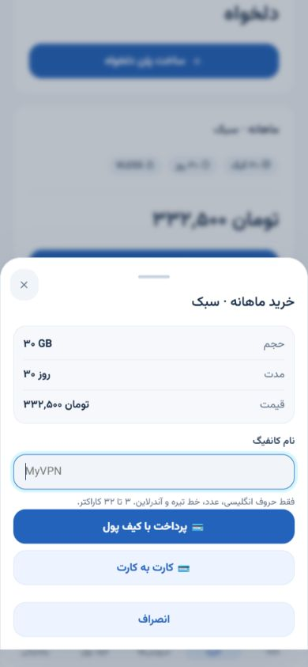

# ارتقای مینی‌اپ — ۱۵ اکتبر ۲۰۲۶

مینی‌اپ با انتخاب کاربر به سبک روشن و مینیمال بازطراحی شد. این تغییر روی همان کد HTML/CSS/JavaScript موجود انجام شده و وابستگی اجرایی جدید ندارد.


## تجربهٔ کاربری

- خانه: موجودی کیف پول، دسترسی سریع به خرید و راهنمای اتصال، تعداد سرویس‌های فعال و هشدارهای حداکثر پنج سرویسِ خلاصه. شمارش هشدارها مربوط به همین خلاصه است.
- منوی پایین پنج گزینه دارد؛ دعوت دوستان، راهنما و ابزارهای مدیر از منوی بالای صفحه در دسترس‌اند.
- سرویس‌ها: جست‌وجوی نام سرویس/پلن با یکسان‌سازی حروف فارسی و عربی، فیلتر فعال و نیازمند توجه، شمارندهٔ نتایج. جست‌وجو و فیلتر روی صفحهٔ دریافت‌شده اعمال می‌شوند؛ صفحه‌بندی و تعداد کل مستقل و قابل مشاهده‌اند.
- حجم نامحدود، زمان نامحدود و شروع اعتبار با اولین اتصال، متن‌های متمایز دارند. انقضای حجم بر اساس مقادیر واقعی است؛ گرد شدن درصد به ۱۰۰٪ باعث انقضای زودرس نمی‌شود.
- درخواستِ در انتظار پنل با هشدار نمایش داده می‌شود و تا دریافت وضعیت جدید، تمدید مجدد از رابط در دسترس نیست. بروزرسانی از دکمهٔ بالای صفحه انجام می‌شود.
- فروشگاه و فرم‌های خرید/تمدید با طرح روشن هماهنگ‌اند؛ پلن بدون محدودیت زمان به صورت «۰ روز» نمایش داده نمی‌شود و پلن بدون موجودی دکمهٔ خرید فعال ندارد.
- پنجره‌ها دکمهٔ بستن، عنوان دسترس‌پذیر، نگه‌داشتن فوکوس داخل پنجره، بازگرداندن فوکوس و پشتیبانی از Escape و دکمهٔ برگشت تلگرام دارند.

## اصلاحات رفتاری

- پاسخ دیررس قیمت تمدید نمی‌تواند قیمتِ درخواست جدید را جایگزین کند. ثبت تمدید تا محاسبهٔ قیمتِ همان مقدار و نوع متوقف می‌شود. مرجع قیمت و مجوز همچنان API است.
- داده‌های خلاصه و فهرست سرویس‌ها هنگام دریافت جدید با هم هماهنگ می‌شوند تا وضعیت قدیمی در جزئیات نمایش داده نشود.
- کیف پول در هر بار ورود/بروزرسانی، موجودی تازه می‌گیرد. خطای تاریخچهٔ پرداخت، موجودی و تاریخچهٔ تراکنشِ موفق را پنهان نمی‌کند.
- دریافت‌های GET شامل بدنه، مهلت ۲۰ ثانیه دارند. هیچ خرید، تمدید یا رسیدی خودکار تکرار نمی‌شود. احراز هویت همچنان با هدر است.
- خطای دریافت با پیام و دکمهٔ تلاش دوباره جایگزین بارگذاری دائمی می‌شود. قطع اینترنتِ گزارش‌شده توسط مرورگر نیز اعلان دارد؛ این اعلان آزمون سلامت پنل نیست.
- نام پلن در جزئیات escape می‌شود و لینک فاکتور تنها با پروتکل HTTP/HTTPS باز می‌شود.

## اعتبارسنجی و پیش‌نمایش

اجرای تست‌های مستقل مینی‌اپ با Node 24:

```sh
node --test miniapp/tests/*.test.mjs
```

۱۲ تست جدید شامل مرز انقضای حجم، سرویس نامحدود، جست‌وجو، وضعیت در انتظار پنل، ترتیب پاسخ قیمت، جلوگیری از ارسال پیش از قیمت، escape نام پلن، موجودی تازه، خطای بخشی از کیف پول، مهلت دریافت و عدم تکرار درخواست مالی است. ۱۶ تست موجود API مینی‌اپ نیز پاس شدند. CSS با PostCSS و نحو JavaScript با Node بررسی شد.

پیش‌نمایش صریح با دادهٔ ساختگی و اتصال فقط به loopback:

```sh
node miniapp/dev/preview.mjs --fixtures
```

آدرس: `http://127.0.0.1:4177/miniapp/`. حالت‌های `?preview=empty`، `?preview=error` و `?preview=admin` برای بررسی رابط وجود دارند. این سرور به API واقعی متصل نمی‌شود؛ خرید، تمدید و ارسال پیام را انجام نمی‌دهد. تصویر QR آن صرفاً جای‌نگهدارِ برچسب‌دار است. فایل پیش‌نمایش در برنامهٔ اصلی وارد یا mount نشده است.

بازبینی مرورگر روی عرض‌های ۳۲۰ و ۳۹۰ و نمایش دسکتاپ انجام شد: خانه، سرویس‌ها، جست‌وجو، فیلتر، جزئیاتِ در انتظار پنل، فروشگاه، خلاصهٔ خرید، کیف پول، راهنما و حالت خطا/خالی. این بررسی جای آزمون روی WebView واقعی Android/iOS و حساب عملیاتی را نمی‌گیرد.

## انتشار

نسخهٔ فایل‌های استاتیک به `v19-20261015` تغییر کرده و رنگ نوار تلگرام با زمینهٔ روشن هماهنگ است. مینی‌اپ به build جاوااسکریپت جداگانه نیاز ندارد؛ در نصب کانتینری، فایل‌ها همراه image سرویس API کپی می‌شوند. انتشار نیاز به دریافت commit جدید و بازسازی/راه‌اندازی سرویس API دارد. این کار به‌تنهایی کد شاخهٔ اصلی یا سرور نصب‌شده را تغییر نمی‌دهد.

## اصلاح واحد پول — نسخهٔ v20

مینی‌اپ قبلاً تنظیم نمایش تومان را دریافت نمی‌کرد و قیمت‌های مشتری با علامت ثابت دلار ساخته می‌شدند. اکنون `/api/miniapp/config`، مقدار ذخیره‌شدهٔ `display_currency` و `toman_rate` را با هدر `no-store` برمی‌گرداند. صفحات مالی پیش از نمایش قیمت، این تنظیم را تازه دریافت می‌کنند؛ شکست دریافت تنظیمات به نمایش دلار با نرخ فرضی تبدیل نمی‌شود.

قیمت پلن، خرید دلخواه، خلاصهٔ خرید، تمدید، کیف پول، تاریخچهٔ تراکنش و پاداش دعوت مطابق انتخاب مدیر نمایش داده می‌شوند. تبدیل نمایش از Decimal رشته‌ای با حساب صحیح انجام می‌شود تا خطای اعشاری JavaScript یک تومان از مبلغ کم نکند. مبالغ واقعی پرداختِ درگاه به واحد ثبت‌شدهٔ خودشان نمایش داده می‌شوند و تومان/ریال/ارز دیجیتال دوباره در نرخ دلار ضرب نمی‌شود. فرم‌های فنی قیمت‌گذاری مدیر که صریحاً «دلار» دارند، قرارداد USD خود را حفظ می‌کنند.

فرم شارژ، واحد انتخاب‌شده را کنار ورودی و پیش‌فرض‌ها نشان می‌دهد و آن واحد را همراه مقدار به API می‌فرستد. سرور ورودی IRT را با نرخ ذخیره‌شده به USD تبدیل می‌کند و مانند قرارداد قبلی شارژ، به دو رقم اعشار نرمال می‌کند. مقدار نهایی واریز در فاکتور/صفحهٔ کارت نمایش داده می‌شود. درخواست قدیمی بدون `currency` همچنان USD است؛ هیچ سابقهٔ مالی بازنویسی نمی‌شود. واحد ورودی در خود فرم نگه داشته می‌شود تا تغییر تنظیمات هنگام باز بودن فرم باعث تفسیر تومان به دلار نشود.

اعتبارسنجی: **۲۰ تست JavaScript** و **۱۴ تست جدید API واحد پول** موفق‌اند. مجموعهٔ کامل محلی Python: **۸۱۸ موفق، ۸ skipped** (۶ PostgreSQL و ۲ ابزار Linux)، با ۱۱ هشدار موجود. حالت‌های دلار و تومان در مرورگر و فرم شارژ در عرض ۳۲۰ پیکسل بررسی شدند. پیش‌نمایش تومانی از `?preview=toman` با نرخ ساختگی ۹۵٬۰۰۰ استفاده می‌کند و هیچ پرداختی انجام نمی‌دهد. فایل‌های استاتیک به `v20-20261015` ارتقا یافتند؛ انتشار مستلزم به‌روزرسانی API و فایل‌های استاتیک با هم است.


